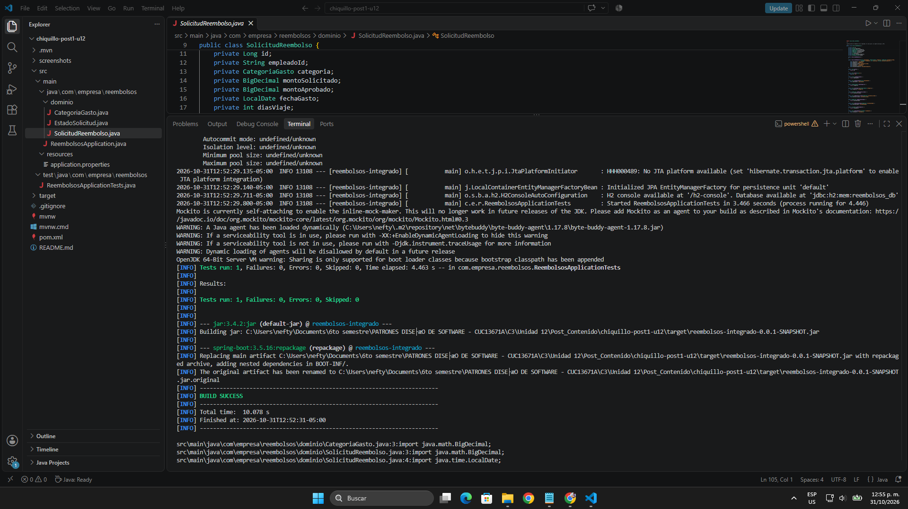
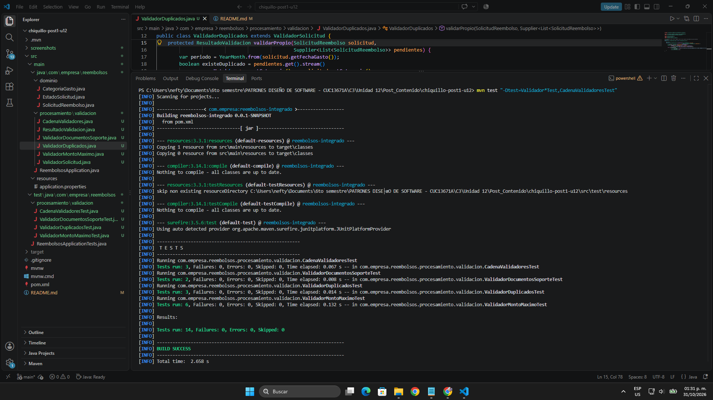
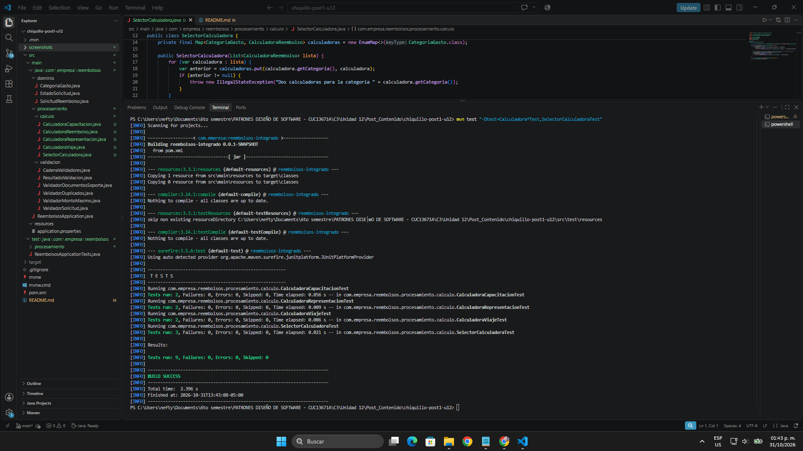
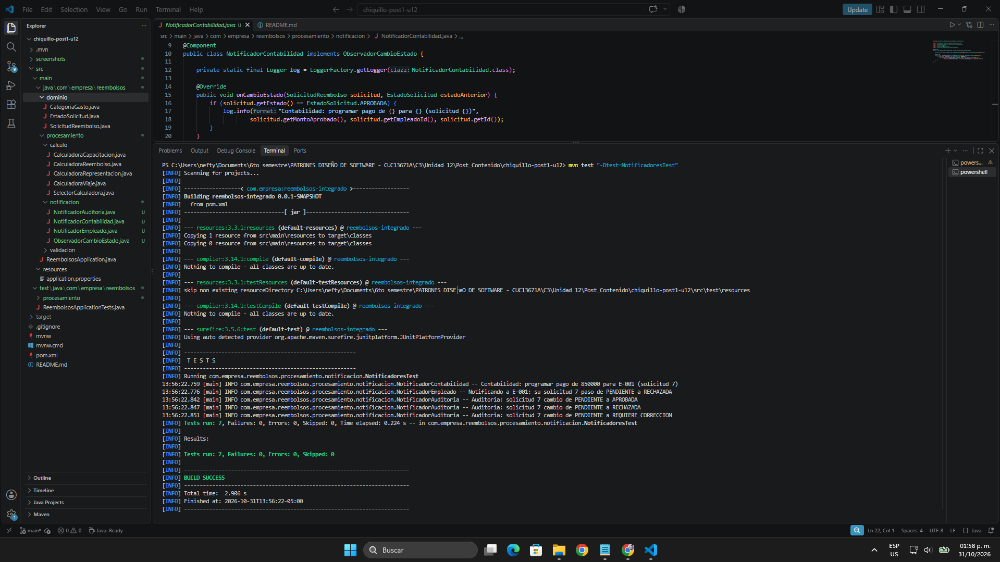
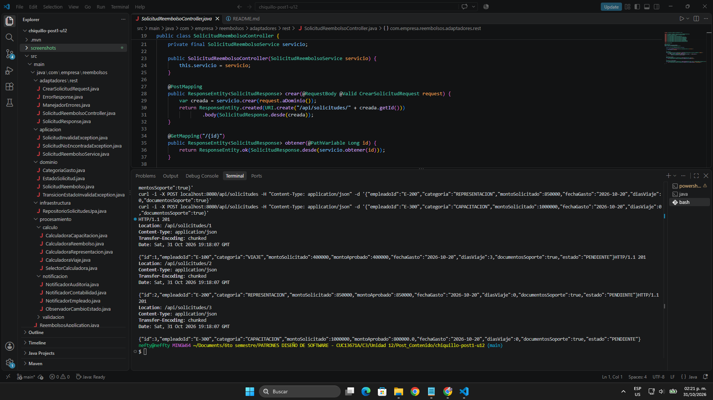
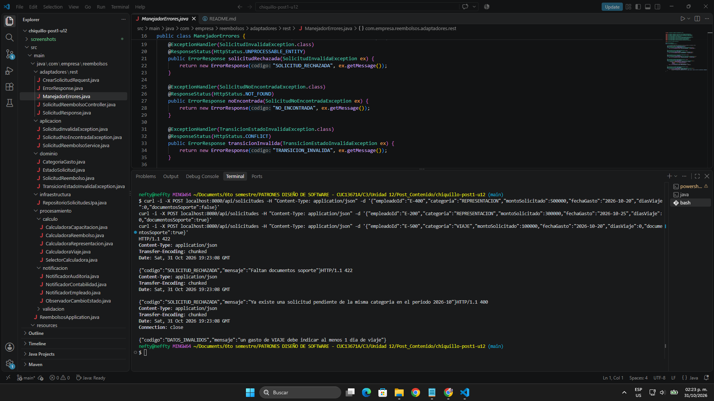
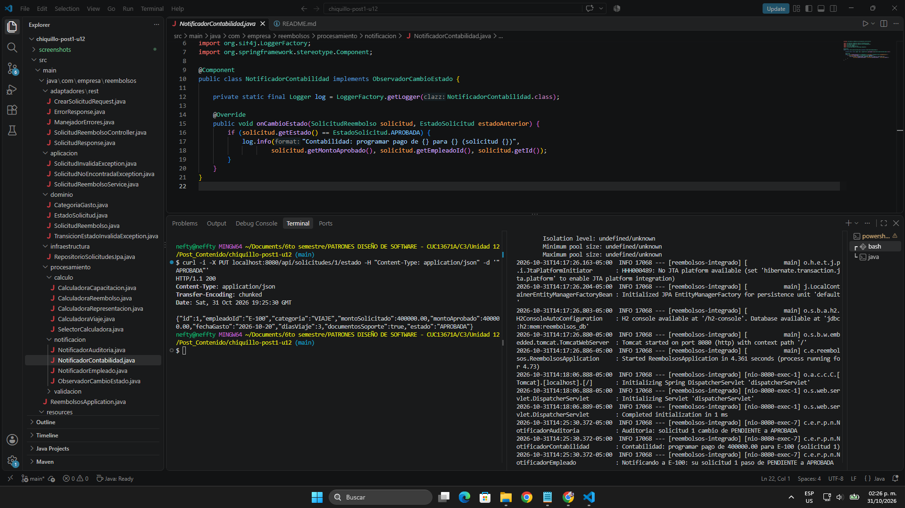
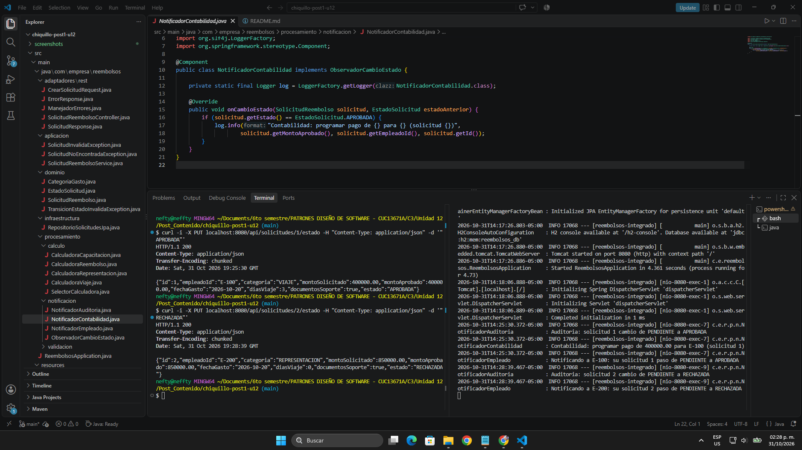
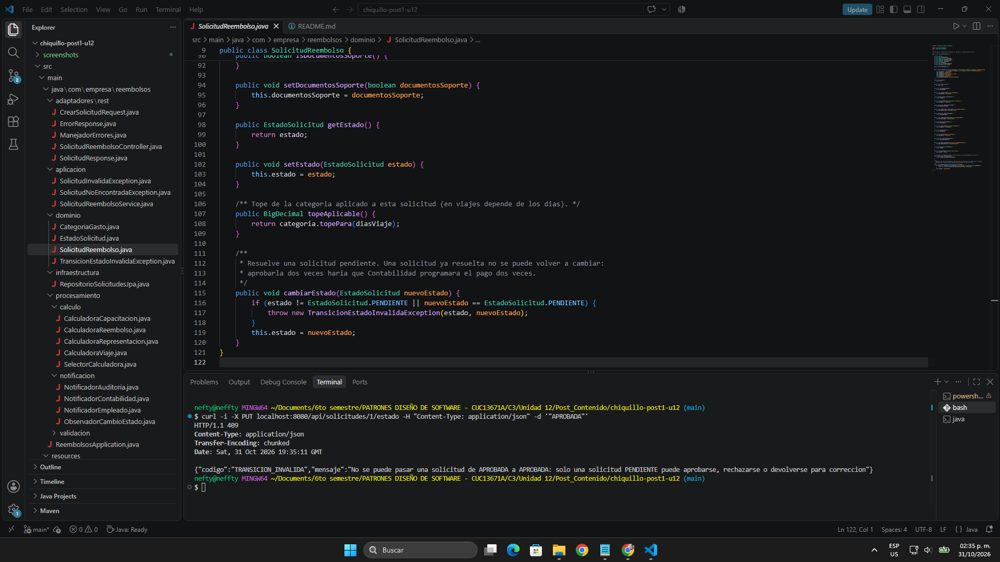
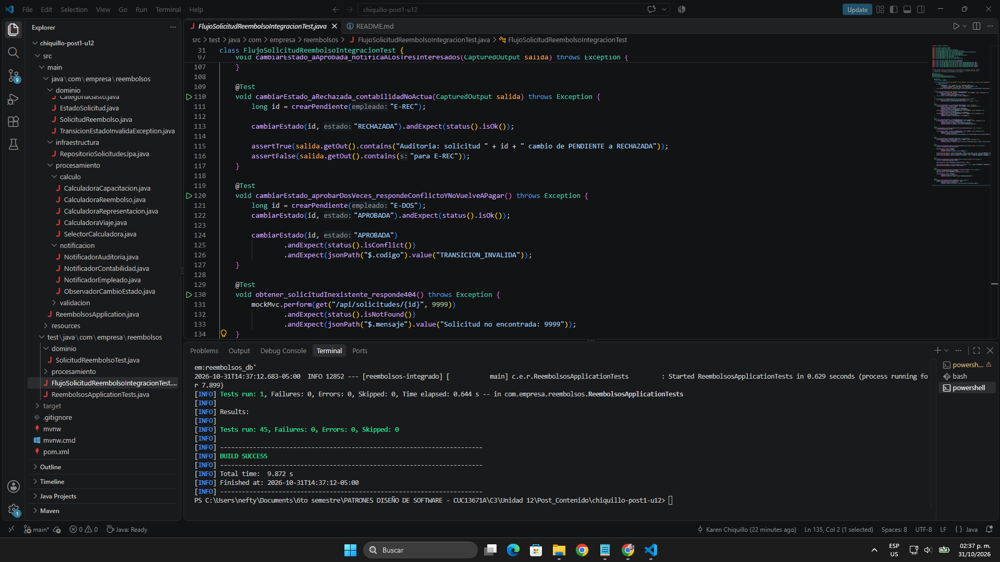

# Post-contenido — Proyecto Integrador: Sistema de Solicitudes de Reembolso de Gastos Corporativos

## Descripción

Repositorio del post-contenido de la Unidad 12 de Patrones de Diseño de Software. Contiene un único proyecto Spring Boot (`reembolsos-integrado`, en la raíz del repositorio) que reemplaza la hoja de cálculo que usa el área de Finanzas para las solicitudes de reembolso de gastos: el empleado registra la categoría, el monto, la fecha del gasto y si adjuntó los documentos soporte; el sistema valida la solicitud, calcula el monto aprobado y avisa a los interesados cada vez que la solicitud cambia de estado.

El enunciado no dice qué patrones usar, así que la primera sección de este README es el análisis de los requisitos, escrito y versionado antes de implementar cualquier patrón.

---

## Diseño Propuesto

Para cada requisito se identificó qué es lo que cambia (el punto de variabilidad), qué patrón lo resuelve y una sola oración que explica por qué ese patrón y no otro, siguiendo el test de explicabilidad de la Guía (sección 1.2).

| Requisito | Qué varía | Patrón | Justificación (una oración) |
|-----------|-----------|--------|-----------------------------|
| RF1 — Validación en varias etapas | La lista de verificaciones: hoy son tres (tope, documentos, duplicados) y Finanzas ya anunció una cuarta (límite anual acumulado). La primera que falla debe detener el proceso. | Chain of Responsibility | Cada verificación es un eslabón que aprueba o rechaza sin saber cuántos eslabones vienen después, así que el límite anual se agrega como un eslabón nuevo sin abrir los tres que ya existen. |
| RF2 — Cálculo por categoría | La fórmula del monto aprobado: tope diario × días, monto completo hasta un tope mensual, 80 % hasta un tope anual, y en el futuro "bienestar". | Strategy | Las tres fórmulas se excluyen entre sí y por cada solicitud se aplica exactamente una según la categoría, que es el caso de Strategy: una clase por fórmula, y una categoría nueva es una clase nueva. |
| RF3 — Notificación a varios interesados | Quiénes se enteran de un cambio de estado y qué hace cada uno: el empleado recibe el resultado, Contabilidad solo reacciona a APROBADA, Auditoría registra todo, y viene un panel de métricas. | Observer | El servicio solo anuncia "esta solicitud pasó de un estado a otro" y cada suscriptor decide qué hacer con eso, así que el panel de métricas se suma como un suscriptor más sin tocar el servicio ni a los otros tres. |

### Por qué no otro patrón

- **RF1:** Strategy no sirve porque aquí no se elige una verificación, se aplican todas en orden. Una `List<Predicate<SolicitudReembolso>>` con `allMatch` sí corta en el primer fallo, pero solo responde `true` o `false` y pierde el mensaje de rechazo propio de cada verificación. Un bloque de `if` dentro del servicio obligaría a modificar el servicio con cada verificación nueva, que es justo lo que RF1 pide evitar.
- **RF2:** un `switch` sobre `CategoriaGasto` obliga a editar el mismo método que ya contiene las otras fórmulas cada vez que llega una categoría. Chain of Responsibility no aplica porque no hay secuencia: solo una fórmula corresponde a cada solicitud. Template Method tampoco, porque las fórmulas no comparten un esqueleto de pasos (una multiplica por días, otra aplica un porcentaje).
- **RF3:** que el servicio llame directamente a los tres notificadores lo acopla a cada interesado y obliga a modificarlo para agregar el panel de métricas. Se usa una interfaz propia (`ObservadorCambioEstado`) y no el bus de eventos de Spring; esa comparación queda documentada en "Qué se descartó y por qué".

### Cómo se combinan los tres patrones

Los tres resuelven preguntas distintas y no se pisan: la cadena decide **si** la solicitud se acepta, la estrategia decide **cuánto** se aprueba y los observadores deciden **a quién** se avisa cuando cambia el estado. `SolicitudReembolsoService` es el único punto que los coordina: la cadena produce un resultado de validación que el servicio consume, y la estrategia solo recibe solicitudes que ya pasaron la cadena (regla de la interfaz compartida, Guía 1.2). Para elegir la calculadora no se escribe una Factory manual: Spring ya inyecta todas las implementaciones como lista, y la Guía (1.2) advierte que una Factory sobre la inyección de dependencias suele ser sobreingeniería.

### Lo que no varía y por eso no lleva patrón

- **La persistencia:** hay un solo motor (H2 con JPA) y ningún plan de cambiarlo, así que no se diseña un puerto de persistencia desde ahora (YAGNI). La decisión formal queda para el ADR de la Parte 2.
- **Los estados:** son cuatro y fijos (`PENDIENTE`, `APROBADA`, `RECHAZADA`, `REQUIERE_CORRECCION`), por lo que basta un `enum`.

### Un dato que comparten RF1 y RF2: el tope de cada categoría

RF1 rechaza una solicitud cuyo monto supere "el tope de la categoría" y RF2 usa esos mismos topes para calcular el monto aprobado. Si el validador y cada calculadora guardan su propia copia de los números, basta con cambiar uno para que queden desincronizados. Además, en viajes el tope depende de los días, así que el validador también tiene que usar tope diario × días: si usara un tope fijo de 150.000, un viaje de 3 días por 400.000 se rechazaría aunque la fórmula de RF2 lo aprueba completo (3 × 150.000 = 450.000). Por eso el tope vive en un solo lugar, el `enum` `CategoriaGasto` del dominio, y tanto la validación como el cálculo lo leen de ahí.

### Modelo de dominio

`SolicitudReembolso`, `CategoriaGasto` y `EstadoSolicitud` están en `dominio/` y no importan ninguna clase de Spring ni de JPA. El mapeo de la solicitud a una tabla se hará fuera del dominio, en `infraestructura/`, cuando se implemente la persistencia.

---

## Decisiones de diseño

### Decisión de diseño 1 — Orden de la cadena de validadores

**Decisión:** `CadenaValidadores` enlaza los eslabones en el orden documentos → monto → duplicados, dejando al final el más caro. **Alternativa descartada:** poner `ValidadorDuplicados` primero.

**Criterio:** ordenar por costo de ejecución, de menor a mayor. `ValidadorDocumentosSoporte` solo lee un `boolean` de la solicitud; `ValidadorMontoMaximo` compara el monto contra el tope del dominio (en viajes, una multiplicación); `ValidadorDuplicados` necesita las solicitudes pendientes del empleado, es decir, una consulta a la base de datos.

| Orden | Qué se gana | Qué se pierde |
|-------|-------------|---------------|
| **Duplicados al final (elegido)** | Una solicitud sin documentos o con monto excesivo se rechaza sin consultar la base de datos. | Si una solicitud tiene varios problemas, el empleado se entera de uno a la vez: corrige los documentos, la reenvía y recién ahí descubre que estaba duplicada. |
| Duplicados primero | El empleado sabe de entrada que la solicitud sobra, antes de buscar documentos que no le van a servir. | Toda solicitud paga la consulta, incluso las que se iban a rechazar por algo que se sabía sin consultar nada. |

**Justificación:** (1) los dos primeros eslabones son verificaciones en memoria y descartan solicitudes sin costo, así que tiene sentido que filtren antes del eslabón que va a la base de datos; (2) se asume, porque todavía no hay datos de uso, que el caso "duplicada y además mal diligenciada" es el menos frecuente: el empleado normalmente sabe si ya envió algo ese mes, mientras que olvidar un documento o pasarse del tope son errores comunes; (3) el orden es fácil de revertir: está en tres líneas del constructor de `CadenaValidadores` y ningún validador depende de su posición.

**Ajuste propio respecto a la guía:** en el código de referencia el servicio carga las pendientes **antes** de entrar a la cadena (`findByEmpleadoIdAndEstado` y luego `validadores.validar(...)`), así que la consulta se hace siempre y el orden de los eslabones no ahorra nada. Para que el criterio de eficiencia tenga efecto real, `ValidadorSolicitud.validar` recibe un `Supplier<List<SolicitudReembolso>>` en vez de la lista ya cargada, y solo `ValidadorDuplicados` llama a `get()`. `CadenaValidadoresTest` lo comprueba contando las consultas: 0 cuando falla documentos, 0 cuando falla monto y 1 cuando la solicitud llega al último eslabón.

### Decisión de diseño 2 — Cómo se elige la calculadora de cada categoría

**Decisión:** `SelectorCalculadora` recibe la `List<CalculadoraReembolso>` que Spring arma con todos los `@Component` que implementan la interfaz, y la convierte en un `EnumMap<CategoriaGasto, CalculadoraReembolso>` usando `getCategoria()` como clave. **Alternativa descartada:** un método con `switch` sobre `CategoriaGasto` que devuelva la calculadora correspondiente.

**Justificación:** RF2 pide agregar categorías "sin modificar el cálculo de las categorías existentes". Con el mapa, agregar "bienestar" significa (1) una constante nueva en `CategoriaGasto` con su tope y (2) una clase `CalculadoraBienestar` anotada con `@Component`; ni `SelectorCalculadora` ni las otras tres calculadoras cambian una sola línea, porque Spring la incluye en la lista por sí solo. Con el `switch` habría que abrir el selector para agregar un `case`, y ese método es el mismo que hoy elige las tres fórmulas existentes, así que cualquier error ahí las afecta a todas.

**Lo que se sacrifica:** un `switch` como expresión sobre un `enum` en Java 17 tiene una ventaja real: si se agrega la constante `BIENESTAR` y se olvida su `case`, el código **no compila**. Con el mapa ese olvido no lo detecta el compilador. Para no perder esa protección, el constructor de `SelectorCalculadora` revisa que todas las categorías tengan exactamente una calculadora y, si falta alguna o hay dos para la misma, lanza `IllegalStateException` **al arrancar la aplicación** (`SelectorCalculadoraTest` lo verifica). El error aparece en el despliegue, no con la primera solicitud de un empleado.

**Ajuste propio respecto a la guía:** el selector de referencia usa `Collectors.toMap` y un `orElseThrow` en `obtener()`, de modo que una categoría sin calculadora solo falla cuando llega una solicitud de esa categoría. Además, las tres calculadoras leen el tope con `solicitud.topeAplicable()`, que viene de `CategoriaGasto`, en lugar de guardar sus propias constantes `TOPE_DIARIO`, `TOPE_MENSUAL` y `TOPE_ANUAL`: es el mismo número que usa `ValidadorMontoMaximo`, como se explicó en el Diseño Propuesto.

### Decisión de diseño 4 — Qué prohíbe la Regla 1 de ArchUnit

**Decisión:** la regla `procesamientoSinPersistenciaNiWeb` prohíbe que `procesamiento/` dependa de `..infraestructura..`, `..adaptadores..`, `org.springframework.data..` y `jakarta.persistence..`, pero **no** de todo `org.springframework`. **Alternativa descartada:** prohibir cualquier dependencia de `org.springframework..` en ese paquete.

**Justificación:** (1) la regla tiene que proteger lo que de verdad acopla: lo que haría que un validador, una calculadora o un notificador dependa de **cómo** se guardan los datos o de **cómo** llegan las peticiones. `@Component` no hace eso: es una marca que le dice a Spring "crea una instancia de esta clase"; no cambia lo que la clase hace, y si mañana se quita, la lógica sigue igual y las pruebas unitarias (que crean los validadores con `new`) no se enteran. Un `JpaRepository` o un `HttpServletRequest`, en cambio, meten la base de datos o HTTP dentro de la regla de negocio. (2) Prohibir todo `org.springframework` obligaría a quitar `@Component` y registrar cada eslabón, cada calculadora y cada notificador con `@Bean` en una clase `@Configuration`; con eso se perdería justamente lo que sostiene la Decisión 2, que una categoría nueva entre como una clase nueva sin tocar ningún otro archivo. (3) Las dependencias de Spring que sí se usan en `procesamiento/` son solo `org.springframework.stereotype.Component`, y el logger es SLF4J, no Spring; la regla deja pasar exactamente eso y nada más del acceso a datos.

**Lo que se sacrifica:** `procesamiento/` no es 100 % independiente del framework: llevarlo a otro contenedor de inyección exigiría quitar las anotaciones. Se acepta porque no hay ningún plan de cambiar Spring (ADR-001) y la lógica en sí ya se prueba sin levantar Spring.

**Ajustes propios a las reglas de la guía:** las cuatro reglas se ejecutaron primero tal como vienen en el enunciado y **tres fallaron**, sin que hubiera una violación real de arquitectura:

| Regla | Por qué falló tal cual | Ajuste |
|-------|------------------------|--------|
| 3 y 4 | `@AnalyzeClasses` también importa las clases de prueba, y estas viven en los mismos paquetes (`CalculadoraViajeTest` está en `procesamiento.calculo`), así que la regla exigía que los tests implementaran las interfaces. | `importOptions = ImportOption.DoNotIncludeTests.class`. |
| 3 | `SelectorCalculadora` está en `procesamiento.calculo` (el mismo lugar que le da la guía) y no implementa `CalculadoraReembolso`, porque no es una estrategia sino quien las elige. | La regla aplica a las clases cuyo nombre empieza por `Calculadora`. Se mantiene el selector junto a las calculadoras por el Common Closure Principle (Guía 3.2: lo que cambia junto va junto). |
| 2 | `onlyAccessClassesThat` cuenta como acceso que una clase use sus propios campos; el constructor del controlador asigna `this.servicio`, y `adaptadores.rest` no estaba en la lista permitida, así que fallaba incluso con el controlador de la guía. Además, `ManejadorErrores` lee los errores con `org.springframework.validation.BindingResult`. | Se agregan `..adaptadores.rest..` (sus propios DTOs) y `org.springframework.validation..`. La regla sigue impidiendo lo importante: que el adaptador llame a `procesamiento` o a `infraestructura` saltándose el servicio. |

Además, Maven Surefire solo ejecuta por defecto las clases que terminan en `Test` o `Tests`, y `ReglasArquitectura` (el nombre que pide el enunciado) no cumple ese patrón: `mvn verify` nunca ejecutaba las reglas. Se agregó al `<includes>` del plugin en el `pom.xml`, y ahora `mvn verify` corre 49 pruebas (45 + 4 reglas).

---

## Qué se descartó y por qué

Cada elemento se evaluó con la pregunta de la Guía (sección 4.2): ¿la variabilidad que justificaría la alternativa es real y está documentada hoy, o es especulación sobre un futuro que todavía no llegó? Ninguno es un descarte definitivo: cada uno dice qué señal haría reconsiderarlo.

### Ejemplos de referencia del enunciado

**1. `ApplicationEventPublisher` en lugar de una lista de observadores inyectada.**
- *Qué se consideró:* publicar un evento de dominio con `ApplicationEventPublisher` y recibirlo con `@EventListener` (Guía, sección 2.3), en lugar de inyectar `List<ObservadorCambioEstado>` en el servicio.
- *Por qué se descartó:* con tres observadores fijos y conocidos al compilar, un bus de eventos genérico no agrega desacoplamiento, porque la interfaz `ObservadorCambioEstado` ya lo da, y sí hace más difícil rastrear en el código quién reacciona a qué cambio (el costo de trazabilidad que la Guía 6.2 atribuye a Observer con eventos).
- *Señal para reconsiderarlo:* la integración de Contabilidad por API externa. ADR-001 deja como condición que esa reacción ocurra después del commit, y `@TransactionalEventListener(phase = AFTER_COMMIT)` es la forma estándar de hacerlo en Spring; si ese es el mecanismo que se elige, los eventos pasan a resolver un problema real.

**2. Visitor o Abstract Factory para exportar reportes en varios formatos.**
- *Qué se consideró:* anticipar que Contabilidad pediría exportar el historial en PDF y en Excel, y construir desde ahora una jerarquía de exportadores.
- *Por qué se descartó:* en este proyecto ni siquiera existe todavía un requisito de exportación; mucho menos un segundo formato. No se cumple la Rule of Three (Guía 4.2): sería resolver un problema que no existe (YAGNI).
- *Señal para reconsiderarlo:* una segunda solicitud real de formato. Con dos se tolera la duplicación; con la tercera se abstrae.

### Elementos propios, surgidos durante la implementación

**3. Patrón State para los estados de la solicitud.**
- *Qué se consideró:* al agregar la regla que impide aprobar dos veces (Desviación 6) apareció la idea de modelar cada estado como una clase (`EstadoPendiente`, `EstadoAprobada`, …) con su propio método `cambiarA(...)`, como enseña el patrón State.
- *Por qué se descartó:* hoy solo hay una regla de transición ("solo una solicitud `PENDIENTE` se puede resolver") y ningún estado tiene comportamiento propio aparte de esa regla. State convertiría un `if` de una línea en `SolicitudReembolso.cambiarEstado()` en una interfaz y cuatro clases. No pasa el test de explicabilidad (Guía 1.2): no se puede decir en una oración qué aporta State que no aporte ese `if` (KISS).
- *Señal para reconsiderarlo:* que los estados empiecen a comportarse distinto. Por ejemplo, que `REQUIERE_CORRECCION` permita al empleado editar y reenviar la solicitud, o que aparezcan estados como `EN_REVISION` o `PAGADA` con reglas propias. Con tres o más estados que tengan lógica distinta, State sí paga su costo.

**4. Entidad JPA separada con un mapper (`SolicitudReembolsoEntity` + `SolicitudMapper`).**
- *Qué se consideró:* para sacar JPA del dominio (Desviación 1), la solución que muestra la Guía de la Unidad 7 es una clase `@Entity` en infraestructura y un mapper que copie los datos entre ella y el objeto de dominio.
- *Por qué se descartó:* el modelo de persistencia y el de dominio son idénticos (los mismos nueve campos). La entidad duplicaría la clase completa y el mapper copiaría campo por campo en las dos direcciones, código que hay que mantener sincronizado sin que agregue nada. `META-INF/orm.xml` logra el mismo aislamiento con cero clases nuevas. Hay una sola forma de persistir, y la Rule of Three dice que no se abstrae con un solo caso: no existe nada que justifique la traducción (YAGNI).
- *Señal para reconsiderarlo:* que la tabla deje de parecerse a la clase, por ejemplo con columnas de auditoría, versionado optimista o una tabla aparte para los documentos soporte; o que llegue el cambio de motor que ADR-001 deja como señal para introducir el puerto de persistencia.

**5. Armar la cadena automáticamente con `List<ValidadorSolicitud>` y `@Order`.**
- *Qué se consideró:* que `CadenaValidadores` recibiera todos los validadores como lista (igual que `SelectorCalculadora`) y los ordenara con `@Order(1)`, `@Order(2)`, `@Order(3)` en cada clase. Así, agregar el "límite anual acumulado" no tocaría `CadenaValidadores`.
- *Por qué se descartó:* el orden de la cadena es una decisión de diseño con justificación propia (Decisión 1), y con `@Order` quedaría repartido en tres archivos distintos como números sueltos, sin un lugar donde leerlo completo. Hoy el orden se lee en una sola línea del constructor (`documentos.siguiente(monto).siguiente(duplicados)`). Con tres validadores, el costo de agregar el cuarto es esa misma línea; la indirección no se paga todavía (Rule of Three).
- *Señal para reconsiderarlo:* cuando la cadena llegue a cinco o seis eslabones, o cuando haya validadores que se activen según la configuración (por ejemplo, solo para ciertas sedes). Ahí sí conviene que cada eslabón declare su posición.

---

## Desviaciones respecto al código de referencia

El enunciado trae código de referencia para cada paso. Al implementarlo y probarlo aparecieron problemas concretos; cada uno se corrigió y queda verificado por una prueba.

| # | Qué hacía el código de referencia | Problema concreto | Qué se hizo | Dónde se comprueba |
|---|-----------------------------------|-------------------|-------------|--------------------|
| 1 | `RepositorioSolicitudesJpa extends JpaRepository<SolicitudReembolso, Long>` | JPA solo administra clases mapeadas como entidad, así que habría que poner `@Entity` y `@Id` en `SolicitudReembolso`, y el checkpoint del Paso 1 exige que el dominio no importe JPA. | El mapeo está en `src/main/resources/META-INF/orm.xml`. El dominio sigue siendo Java puro y el repositorio no cambia. | `FlujoSolicitudReembolsoIntegracionTest` guarda y lee solicitudes; los `import` del dominio son solo `BigDecimal` y `LocalDate` (captura 01). |
| 2 | `ValidadorMontoMaximo` con su propio mapa de topes (VIAJE = 150.000 fijo) y cada calculadora con sus constantes | El tope de VIAJE no tenía en cuenta los días: un viaje de 3 días por 400.000 se rechazaba aunque RF2 lo aprueba completo. Además, los mismos números estaban copiados en dos lugares. | Los topes viven solo en `CategoriaGasto`; en VIAJE el tope es 150.000 × días. Validador y calculadoras leen `solicitud.topeAplicable()`. | `ValidadorMontoMaximoTest.validar_viajeDeTresDiasPor400Mil...` y captura 05. |
| 3 | `ValidadorDuplicados` comparaba `getMonth()` | Comparaba solo el mes: una pendiente de octubre de 2025 bloqueaba una solicitud de octubre de 2026. | Compara `YearMonth` (mes y año). | `ValidadorDuplicadosTest.validar_pendienteMismoMesDeOtroAnio_esValida`. |
| 4 | El servicio cargaba las pendientes antes de la cadena | La consulta se hacía siempre, así que el orden de la Decisión 1 no ahorraba nada. | Los validadores reciben un `Supplier` y la consulta solo ocurre si se llega a `ValidadorDuplicados`. | `CadenaValidadoresTest` (0, 0 y 1 consultas). |
| 5 | El controlador recibía y devolvía `SolicitudReembolso` y no tenía manejo de errores | El cliente podía enviar `estado`, `id` o `montoAprobado`. Una solicitud rechazada terminaba en un 500 sin mensaje claro, y la creación respondía 200. | `CrearSolicitudRequest` y `SolicitudResponse` como DTOs, Bean Validation (VIAJE exige al menos 1 día), `ManejadorErrores` (400, 404, 409, 422) y `201 Created` con `Location`. | Pruebas de integración y capturas 05 y 06. |
| 6 | `cambiarEstado` aceptaba cualquier transición | Una solicitud se podía aprobar dos veces, y cada aprobación hace que Contabilidad programe el pago. | `SolicitudReembolso.cambiarEstado()` solo permite resolver una solicitud `PENDIENTE`; si no, lanza `TransicionEstadoInvalidaException` (409). | `SolicitudReembolsoTest`, `cambiarEstado_aprobarDosVeces...` y captura 09. |
| 7 | Dos notificadores con `System.out.println` y uno con `Logger` | Era inconsistente, y SonarQube marca `System.out` como code smell (Unidad 10). | Los tres usan SLF4J. | `NotificadoresTest` y captura 04. |
| 8 | `SelectorCalculadora` fallaba con la primera solicitud de una categoría sin calculadora | El error aparecía en producción, con un empleado esperando. | Verificación al construir el selector. | `SelectorCalculadoraTest` (Decisión 2). |

**Limitación conocida:** RF2 habla de un tope **mensual** para representación y un tope **anual** para capacitación. Igual que el código de referencia, el sistema aplica esos topes por solicitud y no acumula lo que el empleado ya pidió en el mes o en el año. El lugar natural para resolverlo es un cuarto eslabón de la cadena (RF1 ya anuncia "un límite anual acumulado por empleado"), que se agregaría sin tocar los tres validadores actuales.

---

## Arquitectura resultante

El proyecto está organizado en capas, con un paquete `procesamiento/` que agrupa los tres patrones por requisito y no por tipo de clase. Las dependencias van siempre hacia adentro: `adaptadores` → `aplicacion` → `procesamiento` / `infraestructura` → `dominio`, y `dominio` no depende de nadie.

| Paquete | Responsabilidad | Depende de |
|---------|-----------------|------------|
| `dominio/` | `SolicitudReembolso`, `CategoriaGasto` (con los topes), `EstadoSolicitud` y la regla de transición de estados. Java puro. | Nada |
| `procesamiento/validacion/` | Chain of Responsibility (RF1) | `dominio` |
| `procesamiento/calculo/` | Strategy + selector por categoría (RF2) | `dominio` |
| `procesamiento/notificacion/` | Observer (RF3) | `dominio` |
| `aplicacion/` | `SolicitudReembolsoService`: único punto que coordina los tres patrones y el único que conoce el repositorio. `@Transactional`. | `procesamiento`, `infraestructura`, `dominio` |
| `infraestructura/` | `RepositorioSolicitudesJpa` (Spring Data) + `META-INF/orm.xml` | `dominio` |
| `adaptadores/rest/` | Controlador, DTOs y manejo de errores HTTP | `aplicacion`, `dominio` |

```text
chiquillo-post1-u12/
├── README.md
├── pom.xml
├── mvnw / mvnw.cmd
├── screenshots/
│   └── p1/                                ← Evidencias Parte 1
└── src/
    ├── main/
    │   ├── java/com/empresa/reembolsos/
    │   │   ├── ReembolsosApplication.java
    │   │   ├── dominio/
    │   │   │   ├── CategoriaGasto.java
    │   │   │   ├── EstadoSolicitud.java
    │   │   │   ├── SolicitudReembolso.java
    │   │   │   └── TransicionEstadoInvalidaException.java
    │   │   ├── procesamiento/
    │   │   │   ├── validacion/            ← RF1: Chain of Responsibility
    │   │   │   │   ├── ValidadorSolicitud.java
    │   │   │   │   ├── ValidadorDocumentosSoporte.java
    │   │   │   │   ├── ValidadorMontoMaximo.java
    │   │   │   │   ├── ValidadorDuplicados.java
    │   │   │   │   ├── CadenaValidadores.java
    │   │   │   │   └── ResultadoValidacion.java
    │   │   │   ├── calculo/               ← RF2: Strategy
    │   │   │   │   ├── CalculadoraReembolso.java
    │   │   │   │   ├── CalculadoraViaje.java
    │   │   │   │   ├── CalculadoraRepresentacion.java
    │   │   │   │   ├── CalculadoraCapacitacion.java
    │   │   │   │   └── SelectorCalculadora.java
    │   │   │   └── notificacion/          ← RF3: Observer
    │   │   │       ├── ObservadorCambioEstado.java
    │   │   │       ├── NotificadorEmpleado.java
    │   │   │       ├── NotificadorContabilidad.java
    │   │   │       └── NotificadorAuditoria.java
    │   │   ├── aplicacion/
    │   │   │   ├── SolicitudReembolsoService.java
    │   │   │   ├── SolicitudInvalidaException.java
    │   │   │   └── SolicitudNoEncontradaException.java
    │   │   ├── infraestructura/
    │   │   │   └── RepositorioSolicitudesJpa.java
    │   │   └── adaptadores/rest/
    │   │       ├── SolicitudReembolsoController.java
    │   │       ├── CrearSolicitudRequest.java
    │   │       ├── SolicitudResponse.java
    │   │       ├── ErrorResponse.java
    │   │       └── ManejadorErrores.java
    │   └── resources/
    │       ├── application.properties
    │       └── META-INF/orm.xml           ← Mapeo JPA fuera del dominio
    └── test/java/com/empresa/reembolsos/  ← Pruebas unitarias y de integración
```

### Endpoints

| Método | Ruta | Cuerpo | Respuestas |
|--------|------|--------|------------|
| `POST` | `/api/solicitudes` | `CrearSolicitudRequest` (JSON) | 201 / 400 datos inválidos / 422 rechazada por la cadena |
| `GET` | `/api/solicitudes/{id}` | — | 200 / 404 |
| `PUT` | `/api/solicitudes/{id}/estado` | `"APROBADA"`, `"RECHAZADA"` o `"REQUIERE_CORRECCION"` | 200 / 404 / 409 transición inválida |

---

## Cómo ejecutar

Requisitos: Java 17 o superior y Maven 3.8+ (o el wrapper incluido).

```bash
mvn clean package
mvn spring-boot:run
```

> En Windows con el wrapper: `.\mvnw.cmd clean package` y `.\mvnw.cmd spring-boot:run`.

- API: `http://localhost:8080/api/solicitudes`
- Consola H2: `http://localhost:8080/h2-console` (JDBC URL `jdbc:h2:mem:reembolsos_db`, usuario `sa`, sin contraseña)

Ejemplo (Git Bash):

```bash
curl -i -X POST localhost:8080/api/solicitudes -H "Content-Type: application/json" \
  -d '{"empleadoId":"E-100","categoria":"VIAJE","montoSolicitado":400000,"fechaGasto":"2026-10-20","diasViaje":3,"documentosSoporte":true}'

curl -i -X PUT localhost:8080/api/solicitudes/1/estado -H "Content-Type: application/json" -d '"APROBADA"'
```

---

## Pruebas

`mvn test` ejecuta **45 pruebas**: 36 unitarias sin levantar el contexto de Spring, 8 de integración con `@SpringBootTest` y la de arranque del contexto.

| Clase | Tipo | Pruebas | Qué verifica |
|-------|------|---------|--------------|
| `ValidadorDocumentosSoporteTest` | Unitaria | 2 | Rechazo sin documentos y aceptación con documentos |
| `ValidadorMontoMaximoTest` | Unitaria | 6 | Tope de viaje diario × días; límites exactos de representación y capacitación |
| `ValidadorDuplicadosTest` | Unitaria | 3 | Mismo periodo rechaza; mismo mes de otro año y otra categoría pasan |
| `CadenaValidadoresTest` | Unitaria | 3 | Corte anticipado y número de consultas de pendientes (Decisión 1) |
| `CalculadoraViajeTest` | Unitaria | 2 | Monto completo dentro del tope; tope diario × días cuando se pasa |
| `CalculadoraRepresentacionTest` | Unitaria | 2 | Monto completo; tope de 2.000.000 |
| `CalculadoraCapacitacionTest` | Unitaria | 2 | 80 % del monto; tope de 3.000.000 |
| `SelectorCalculadoraTest` | Unitaria | 3 | Selección por categoría; falla al arrancar si falta o se repite una calculadora (Decisión 2) |
| `NotificadoresTest` | Unitaria | 7 | Empleado siempre; Contabilidad solo con APROBADA; Auditoría en todo cambio |
| `SolicitudReembolsoTest` | Unitaria | 6 | Transiciones válidas e inválidas; tope aplicable en viaje |
| `FlujoSolicitudReembolsoIntegracionTest` | Integración (`@SpringBootTest`) | 8 | Flujo completo HTTP → servicio → patrones → H2 para las tres categorías, rechazos, notificación y 409 |
| `ReembolsosApplicationTests` | Integración | 1 | El contexto de Spring arranca |

---

## Evidencias de pruebas — Parte 1

| # | Prueba | Resultado |
|---|--------|-----------|
| 1 | `mvn clean package` + `import` del dominio | `BUILD SUCCESS`; el dominio solo importa `BigDecimal` y `LocalDate` |
| 2 | Pruebas de la cadena de validadores | 14 pruebas en verde |
| 3 | Pruebas de calculadoras y selector | 9 pruebas en verde |
| 4 | Pruebas de los notificadores | 7 pruebas en verde; Contabilidad solo escribe con APROBADA |
| 5 | `POST` de las tres categorías | 201; aprobado 400.000 (viaje de 3 días), 850.000 y 800.000 (80 %) |
| 6 | `POST` sin documentos, duplicada y viaje sin días | 422, 422 y 400 con mensaje claro |
| 7 | `PUT` a APROBADA | 200; el log muestra Auditoría, Contabilidad y Empleado |
| 8 | `PUT` a RECHAZADA | 200; el log muestra Auditoría y Empleado, sin Contabilidad |
| 9 | `PUT` a APROBADA sobre una solicitud ya aprobada | 409 `TRANSICION_INVALIDA` |
| 10 | `mvn test` completo | 45 pruebas, 0 fallos |












---

## Herramientas utilizadas

- Java 17, Spring Boot 3.5.16 (Spring Web, Spring Data JPA, Validation), H2
- JUnit 5, MockMvc, `OutputCaptureExtension`
- Apache Maven, Git, GitHub, cURL (Git Bash), Visual Studio Code

---

## Conclusiones

La Parte 1 mostró que escribir el Diseño Propuesto antes del código obliga a encontrar el punto de variabilidad de cada requisito, y por eso cada patrón terminó respondiendo una pregunta distinta: la cadena decide si la solicitud entra, la estrategia cuánto se aprueba y los observadores a quién se avisa. Lo que más aportó fue probar el código de referencia en lugar de copiarlo, porque así aparecieron el tope de viaje que no contaba los días, los duplicados que solo miraban el mes y el dominio que no podía quedar libre de JPA. Lo que más costó fue decidir dónde vive cada regla sin agregar clases de más: el tope terminó en el dominio porque validador y calculadoras ya lo conocían, y el `orm.xml` evitó tanto el `@Entity` en el dominio como una entidad JPA aparte con su mapper, aunque fue la parte que más hubo que investigar.
